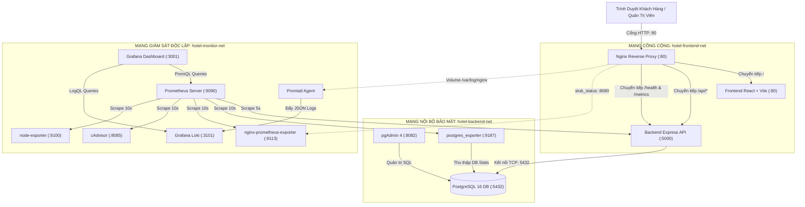

# BÁO CÁO KẾT THÚC HỌC PHẦN (KTHP)
## MÔN HỌC: TRIỂN KHAI VÀ QUẢN TRỊ HỆ THỐNG PHẦN MỀM
### ĐỀ TÀI 6: XÂY DỰNG VÀ QUẢN TRỊ HỆ THỐNG ĐẶT PHÒNG KHÁCH SẠN BẰNG DOCKER COMPOSE

---

## MỤC LỤC
1. [LỜI MỞ ĐẦU](#1-lời-mở-đầu)
2. [CHƯƠNG 1: TỔNG QUAN VỀ ĐỀ TÀI VÀ MỤC TIÊU DỰ ÁN](#chương-1-tổng-quan-về-đề-tài-và-mục-tiêu-dự-án)
   - 1.1. Bối cảnh và lý do chọn đề tài
   - 1.2. Mục tiêu hệ thống
   - 1.3. Bảng công nghệ bắt buộc
3. [CHƯƠNG 2: THIẾT KẾ KIẾN TRÚC VÀ MẠNG HỆ THỐNG](#chương-2-thiết-kế-kiến-trúc-và-mạng-hệ-thống)
   - 2.1. Sơ đồ kiến trúc tổng thể (Architecture Diagram)
   - 2.2. Phân vùng mạng và an ninh Zero-Trust (Network Segmentation)
   - 2.3. Bảng phân bổ cổng (Port Mapping) và biến môi trường
4. [CHƯƠNG 3: THIẾT KẾ CƠ SỞ DỮ LIỆU VÀ CƠ CHẾ AN TOÀN GIAO DỊCH](#chương-3-thiết-kế-cơ-sở-dữ-liệu-và-cơ-chế-an-toàn-giao-dịch)
   - 3.1. Thiết kế cơ sở dữ liệu quan hệ PostgreSQL 16 (Chuẩn 3NF)
   - 3.2. Cơ chế khóa dòng (Row-level Lock) và ngăn chặn đặt trùng phòng đồng thời
   - 3.3. Quy tắc tính toán tổng tiền độc quyền phía Backend
   - 3.4. Bảo mật tra cứu thông tin (Xác thực Mã đặt phòng VÀ Email)
   - 3.5. Quy tắc hủy phòng và lưu vết kiểm toán (Audit Trail)
5. [CHƯƠNG 4: HIỆN THỰC CÁC THÀNH PHẦN ỨNG DỤNG VÀ PHÂN QUYỀN](#chương-4-hiện-thực-các-thành-phần-ứng-dụng-và-phân-quyền)
   - 4.1. Xác thực và Phân quyền Quản trị (Bcrypt + JWT Authentication)
   - 4.2. Bảo vệ API Quản trị (Không cho người dùng thường gọi API quản trị)
   - 4.3. Loại trừ thông tin nhạy cảm khỏi hệ thống ghi Log (Sanitized Logging)
   - 4.4. Frontend React + Vite với giao diện 5 sao và tab quản trị khách hàng
   - 4.5. Nginx Reverse Proxy và bảo mật HTTP Headers
6. [CHƯƠNG 5: CONTAINER HÓA VÀ ĐIỀU PHỐI VỚI DOCKER COMPOSE](#chương-5-container-hóa-và-điều-phối-với-docker-compose)
   - 5.1. Tối ưu hóa Dockerfile (Multi-stage build & Non-root user)
   - 5.2. Cấu trúc file docker-compose.yml toàn diện (13 dịch vụ)
   - 5.3. Quản lý tài nguyên và cơ chế tự phục hồi (Healthcheck & Limits)
7. [CHƯƠNG 6: HỆ THỐNG GIÁM SÁT TOÀN DIỆN (MONITORING STACK)](#chương-6-hệ-thống-giám-sát-toàn-diện-monitoring-stack)
   - 6.1. Prometheus Server và các quy tắc cảnh báo (Alert Rules)
   - 6.2. Các bộ thu thập chỉ số (Exporters)
   - 6.3. Trực quan hóa với Grafana Dashboards
8. [CHƯƠNG 7: HỆ THỐNG QUẢN LÝ LOG TẬP TRUNG (LOGGING STACK)](#chương-7-hệ-thống-quản-lý-log-tập-trung-logging-stack)
   - 7.1. Kiến trúc Grafana Loki & Promtail
   - 7.2. Pipeline xử lý JSON Structured Log
9. [CHƯƠNG 8: KẾT QUẢ KIỂM THỬ VÀ KẾ HOẠCH BẢO TRÌ](#chương-8-kết-quả-kiểm-thử-và-kế-hoạch-bảo-trì)
   - 8.1. Kịch bản kiểm thử tự động (End-to-End Test Suite)
   - 8.2. Kiểm tra ngăn chặn đặt trùng phòng (Concurrency Test)
   - 8.3. Kế hoạch sao lưu và phục hồi thảm họa (Disaster Recovery)
10. [KẾT LUẬN VÀ HƯỚNG PHÁT TRIỂN](#kết-luận-và-hướng-phát-triển)

---

## 1. LỜI MỞ ĐẦU

Trong thời đại số hóa và phát triển mạnh mẽ của điện toán đám mây (Cloud Computing), các ứng dụng phần mềm không chỉ đơn thuần là việc hoàn thiện các tính năng nghiệp vụ người dùng, mà còn đòi hỏi một hạ tầng triển khai mạnh mẽ, có khả năng mở rộng (scalability), độ sẵn sàng cao (high availability), giám sát thời gian thực (real-time observability) và bảo mật an toàn thông tin.

Báo cáo này tổng hợp kết quả nghiên cứu, xây dựng và triển khai thực nghiệm cho **Đề tài 6: Hệ thống Đặt phòng Khách sạn bằng Docker Compose** trong khuôn khổ học phần *"Triển khai và Quản trị Hệ thống Phần mềm"*. Dự án không sử dụng các giải pháp giả lập, mà được xây dựng từ các thành phần mã nguồn thực tế, tuân thủ các quy chuẩn kỹ thuật chuyên nghiệp trong vận hành và quản trị hệ thống DevOps.

---

## CHƯƠNG 1: TỔNG QUAN VỀ ĐỀ TÀI VÀ MỤC TIÊU DỰ ÁN

### 1.1. Bối cảnh và lý do chọn đề tài
Ngành công nghiệp khách sạn và nghỉ dưỡng (Hospitality) đòi hỏi hệ thống đặt phòng trực tuyến phải hoạt động liên tục 24/7/365, tốc độ phản hồi tính bằng mili-giây và tuyệt đối không được xảy ra tình trạng "đặt trùng phòng" (double-booking). Để giải quyết bài toán này, việc áp dụng kiến trúc microservices container hóa kết hợp reverse proxy, hệ thống cơ sở dữ liệu quan hệ với cơ chế khóa dòng (row-level locking), đi kèm bộ công cụ quan sát toàn diện (Observability: Metrics, Logs) là giải pháp tiêu chuẩn của các hệ sinh thái công nghệ hàng đầu thế giới.

### 1.2. Mục tiêu hệ thống
1. **Về nghiệp vụ người dùng:** Cung cấp trải nghiệm đặt phòng nghỉ dưỡng 5 sao sang trọng (Aurora Grand Resort & Spa), hỗ trợ tìm kiếm phòng theo ngày, lọc theo phân khúc giá và sức chứa, tự động tính tổng tiền và tra cứu trạng thái đơn đặt phòng an toàn.
2. **Về quản trị:** Cung cấp Dashboard quản trị viên có phân quyền rõ ràng (Admin/Staff), đăng nhập bằng mật khẩu mã hóa Bcrypt và JWT Token, theo dõi doanh thu thực tế, tình trạng lấp đầy phòng, CRUD phòng và cập nhật trạng thái đơn hàng.
3. **Về triển khai hệ thống:** Đóng gói toàn bộ 13 dịch vụ vào container Docker và điều phối thống nhất thông qua một file `docker-compose.yml`.
4. **Về an toàn thông tin & Quản trị CSDL:**
   - Phân tách bảng `customers` (thông tin khách hàng) và `bookings` (thông tin đặt phòng).
   - Kiểm tra xung đột ngày và khóa dòng `FOR UPDATE` ngăn chặn double-booking đồng thời.
   - Tính toán tiền độc quyền ở máy chủ, không tin tưởng giá gửi từ frontend.
   - Xác thực cả Mã đặt phòng VÀ Email khi tra cứu và hủy phòng để bảo vệ quyền riêng tư.
   - Không ghi mật khẩu, token vào hệ thống log.

### 1.3. Bảng công nghệ bắt buộc

| Thành phần | Lựa chọn công nghệ | Phiên bản cố định | Vai trò trong hệ thống |
| :--- | :--- | :--- | :--- |
| **Frontend** | React + Vite | React 18.3, Vite 5.4 | Xây dựng giao diện web SPA tiếng Việt chuẩn 5 sao |
| **Backend** | Node.js + Express | Node.js 20 LTS | Xử lý logic nghiệp vụ, REST API, prom-client |
| **Database** | PostgreSQL | `postgres:16-alpine` | Lưu trữ dữ liệu quan hệ, ACID transaction, khóa dòng |
| **DB Admin** | pgAdmin 4 | `dpage/pgadmin4:8.12` | Giao diện đồ họa quản trị CSDL qua trình duyệt |
| **Reverse Proxy** | Nginx | `nginx:1.27-alpine` | Định tuyến traffic, bảo mật, nén dữ liệu, stub_status |
| **Monitoring** | Prometheus | `prom/prometheus:v2.54.1` | Máy chủ cào và lưu trữ dữ liệu chuỗi thời gian |
| **Visualization**| Grafana | `grafana/grafana:11.2.0` | Bảng điều khiển phân tích số liệu trực quan |
| **Logging** | Loki | `grafana/loki:3.1.1` | Cơ sở dữ liệu lưu trữ log tập trung |
| **Log Collector**| Promtail | `grafana/promtail:3.1.1` | Đọc và đẩy log từ Nginx và Docker containers về Loki |
| **Container Met**| cAdvisor | `cadvisor:v0.49.1` | Thu thập số liệu tài nguyên từng container |
| **Host Metrics** | Node Exporter | `node-exporter:v1.8.2` | Thu thập chỉ số phần cứng máy chủ |
| **Nginx Met** | Nginx Exporter | `nginx-prometheus-exporter:1.3.0` | Cào chỉ số kết nối Nginx |
| **Postgres Met** | Postgres Exporter| `postgres-exporter:v0.15.0` | Cào chỉ số giao dịch PostgreSQL |
| **Orchestration**| Docker Compose | Compose Specification v2 | Điều phối, phân mạng và quản lý vòng đời container |

---

## CHƯƠNG 2: THIẾT KẾ KIẾN TRÚC VÀ MẠNG HỆ THỐNG

### 2.1. Sơ đồ kiến trúc tổng thể (Architecture Diagram)



### 2.2. Phân vùng mạng và an ninh Zero-Trust (Network Segmentation)

Hệ thống phân tách thành 3 mạng Docker bridge riêng biệt:
1. **`hotel-frontend-net`:** Chỉ gồm Nginx, Frontend, Backend. Nginx là điểm vào duy nhất từ Internet.
2. **`hotel-backend-net`:** Mạng nội bộ bảo vệ PostgreSQL. Cổng 5432 của DB **không bị public** ra ngoài môi trường Internet.
3. **`hotel-monitor-net`:** Mạng telemetry cô lập Prometheus, Grafana, Loki và các Exporters.

---

## CHƯƠNG 3: THIẾT KẾ CƠ SỞ DỮ LIỆU VÀ CƠ CHẾ AN TOÀN GIAO DỊCH

### 3.1. Thiết kế cơ sở dữ liệu quan hệ PostgreSQL 16 (Chuẩn 3NF)

Lược đồ cơ sở dữ liệu được định nghĩa chặt chẽ trong `database/init.sql`:

1. **`users`:** `id`, `username` (UNIQUE), `password_hash`, `full_name`, `email` (UNIQUE), `role` (`admin`, `staff`, `manager`), `created_at`.
2. **`customers`:** `id`, `full_name`, `email`, `phone`, `id_card` (CCCD/Hộ chiếu), `address`, `created_at`. Ràng buộc: `UNIQUE (email, phone)`.
3. **`room_types`:** `id`, `code` (UNIQUE), `name`, `description`, `base_price`, `max_guests`, `bed_type`, `room_size`, `image_url`. Ràng buộc: `CHECK (base_price > 0)`.
4. **`amenities`:** `id`, `name` (UNIQUE), `category`, `icon`.
5. **`rooms`:** `id`, `room_number` (UNIQUE), `room_type_id` (FK `room_types`), `title`, `floor`, `price_per_night`, `max_guests`, `status` (`available`, `occupied`, `maintenance`), `description`, `image_url`, `images`, `amenities`.
6. **`bookings`:** `id`, `booking_code` (UNIQUE), `customer_id` (FK `customers`), `room_id` (FK `rooms`), `check_in_date`, `check_out_date`, `num_guests`, `total_nights`, `room_price`, `total_amount`, `special_requests`, `status` (`pending`, `confirmed`, `checked_in`, `checked_out`, `cancelled`), `payment_status`. Ràng buộc: `CONSTRAINT check_booking_dates CHECK (check_out_date > check_in_date)`.
7. **`booking_status_history`:** `id`, `booking_id` (FK `bookings`), `old_status`, `new_status`, `changed_by`, `notes`, `created_at`.

**Chỉ mục truy vấn (Indexes):**
- `idx_bookings_room_dates ON bookings (room_id, check_in_date, check_out_date, status)`
- `idx_bookings_code ON bookings (booking_code)`
- `idx_bookings_customer ON bookings (customer_id)`
- `idx_customers_email ON customers (email)`
- `idx_customers_phone ON customers (phone)`
- `idx_rooms_status ON rooms (status)`

### 3.2. Cơ chế khóa dòng và ngăn chặn đặt trùng phòng đồng thời

Để giải quyết triệt để vấn đề xung đột đồng thời (Concurrency Race Condition), Backend triển khai Transaction mức độ cao với khóa bi quan (Pessimistic Locking):
```javascript
await client.query('BEGIN');

// 1. Khóa dòng bản ghi phòng được yêu cầu
const room = await client.query('SELECT * FROM rooms WHERE id = $1 FOR UPDATE', [room_id]);

// 2. Kiểm tra xung đột lịch đặt phòng
const conflict = await client.query(`
  SELECT id FROM bookings
  WHERE room_id = $1 
    AND status NOT IN ('cancelled')
    AND NOT (check_out_date <= $2::date OR check_in_date >= $3::date)
`, [room_id, check_in_date, check_out_date]);

if (conflict.rows.length > 0) {
  await client.query('ROLLBACK');
  return res.status(409).json({ success: false, message: 'Phòng đã có khách đặt trong khoảng thời gian này' });
}
```
Khi hai request cùng gửi đến để đặt cùng một phòng trong cùng khoảng thời gian, câu lệnh `SELECT ... FOR UPDATE` buộc request thứ hai phải đợi cho đến khi transaction thứ nhất hoàn tất `COMMIT`. Tại thời điểm request thứ hai được xử lý, truy vấn kiểm tra xung đột sẽ phát hiện đơn đặt phòng vừa tạo và trả về mã lỗi `409 Conflict`, bảo đảm không bao giờ xảy ra double-booking.

### 3.3. Quy tắc tính toán tổng tiền độc quyền phía Backend

Hệ thống tuân thủ nguyên tắc an ninh "Không tin tưởng dữ liệu đầu vào từ client":
- Client chỉ gửi `check_in_date`, `check_out_date`, `room_id`, `num_guests`.
- Backend trực tiếp tính toán:
  - `total_nights = Math.ceil((checkOut - checkIn) / (1000 * 60 * 60 * 24))`
  - Lấy `price_per_night` trực tiếp từ bảng `rooms` trong CSDL.
  - `total_amount = total_nights * price_per_night`.
- Toàn bộ giá trị tiền tệ trong CSDL được bảo toàn tính toàn vẹn tuyệt đối.

### 3.4. Bảo mật tra cứu thông tin (Xác thực Mã đặt phòng VÀ Email)

Để ngăn chặn kẻ xấu quét thông tin đặt phòng của khách hàng khác:
- API `GET /api/bookings/lookup` bắt buộc cung cấp đồng thời cả `code` (Mã đặt phòng) VÀ `email` (Email khách đăng ký):
  ```sql
  SELECT b.*, c.full_name, c.email FROM bookings b
  JOIN customers c ON b.customer_id = c.id
  WHERE UPPER(b.booking_code) = UPPER($1) AND LOWER(c.email) = LOWER($2)
  ```
- Nếu chỉ biết mã phòng mà nhập sai email hoặc ngược lại, hệ thống trả về mã lỗi `404 Not Found`.

### 3.5. Quy tắc hủy phòng và lưu vết kiểm toán (Audit Trail)

- Khách hàng chỉ được phép hủy phòng khi đơn đang ở trạng thái `confirmed` hoặc `pending` và cách ngày nhận phòng ít nhất 24 giờ.
- Không thực hiện xóa cứng dòng dữ liệu (`DELETE FROM bookings`), mà thực hiện **Soft Cancel**:
  ```sql
  UPDATE bookings SET status = 'cancelled' WHERE id = $1;
  ```
- Mọi thao tác hủy hoặc chuyển trạng thái đều được tự động ghi nhận vào bảng `booking_status_history` lưu rõ thời gian, người thực hiện (`changed_by`) và lý do.

---

## CHƯƠNG 4: HIỆN THỰC CÁC THÀNH PHẦN ỨNG DỤNG VÀ PHÂN QUYỀN

### 4.1. Xác thực và Phân quyền Quản trị (Bcrypt + JWT Authentication)

- **Mật khẩu an toàn:** Mật khẩu trong bảng `users` được băm bằng thuật toán **Bcrypt** với Salt rounds = 10 (`$2a$10$...`).
- **Cấp phát JWT:** Khi người dùng gửi request `POST /api/auth/login`, backend kiểm tra username qua câu lệnh tham số hóa, dùng `bcrypt.compareSync` xác thực mật khẩu. Khi thành công, cấp phát JWT Bearer Token chứa `id, username, full_name, role` có thời hạn 24 giờ.

### 4.2. Bảo vệ API Quản trị

Middleware `authenticateJWT`, `requireAdmin` và `requireStaffOrAdmin` được gắn trước toàn bộ các API quản trị:
- `POST /api/rooms`, `PUT /api/rooms/:id`, `DELETE /api/rooms/:id`: Yêu cầu quyền `admin`.
- `GET /api/admin/customers`: Yêu cầu quyền `admin` hoặc `staff`.
- `GET /api/bookings` (toàn bộ danh sách đơn): Yêu cầu quyền `admin` hoặc `staff`.
- `PUT /api/bookings/:id/status`: Yêu cầu quyền `admin` hoặc `staff`.
- `GET /api/dashboard/stats`: Yêu cầu quyền `admin` hoặc `staff`.

Nếu người dùng thông thường hoặc kẻ tấn công cố tình gọi các endpoint này mà không có token hợp lệ, hệ thống sẽ trả về mã `401 Unauthorized` hoặc `403 Forbidden`.

### 4.3. Loại trừ thông tin nhạy cảm khỏi hệ thống ghi Log (Sanitized Logging)

Middleware `requestLogger` được lập trình lọc bỏ toàn bộ các query params và headers nhạy cảm như `password`, `token`, `secret`, `authorization`, thay thế bằng `[REDACTED]` trước khi gửi bản tin JSON ra console cho Promtail thu thập.

### 4.4. Frontend React + Vite với giao diện 5 sao và tab quản lý khách hàng

- Giao diện Vanilla CSS cao cấp: Glassmorphism, Gold luxury theme, responsive trên thiết bị di động.
- Trang Quản trị kiểm tra trạng thái đăng nhập qua `localStorage`. Nếu chưa đăng nhập, tự động chuyển về màn hình đăng nhập quản trị viên.
- Cung cấp Tab "Khách hàng" hiển thị bảng dữ liệu khách hàng, số điện thoại, email, số CCCD và tổng chi tiêu.
- Cung cấp chức năng xem lịch sử thay đổi trạng thái (Audit Trail modal).

### 4.5. Nginx Reverse Proxy và bảo mật HTTP Headers

- Chuyển tiếp cổng 80 đến Frontend và Backend.
- Bật nén Gzip.
- Thiết lập các HTTP Security Headers (`X-Frame-Options: SAMEORIGIN`, `X-Content-Type-Options: nosniff`, `X-XSS-Protection: 1; mode=block`).
- Mở cổng `8080` (ánh xạ host `8089`) cung cấp `/stub_status` cho Nginx Prometheus Exporter.

---

## CHƯƠNG 5: CONTAINER HÓA VÀ ĐIỀU PHỐI VỚI DOCKER COMPOSE

### 5.1. Tối ưu hóa Dockerfile

1. **Frontend Dockerfile:** Multi-stage build (Node 20 build -> Nginx 1.27 Alpine runtime), dung lượng image < 30MB.
2. **Backend Dockerfile:** Alpine base, chạy dưới quyền `USER node` (non-root) để bảo vệ máy chủ Docker Host. Tích hợp lệnh `HEALTHCHECK`.

### 5.2. Cấu trúc file docker-compose.yml toàn diện (13 dịch vụ)

Toàn bộ 13 dịch vụ (`postgres`, `backend`, `frontend`, `nginx`, `pgadmin`, `prometheus`, `grafana`, `loki`, `promtail`, `cadvisor`, `node-exporter`, `nginx-exporter`, `postgres-exporter`) được điều phối với:
- `depends_on` kèm `condition: service_healthy`.
- Gán tài nguyên CPU và RAM tối đa qua `deploy.resources.limits`.
- Lưu trữ bền vững qua 6 Named Volumes.

---

## CHƯƠNG 6: HỆ THỐNG GIÁM SÁT TOÀN DIỆN (MONITORING STACK)

### 6.1. Prometheus Server và Alert Rules
Prometheus cấu hình cào 6 Targets chu kỳ 5s - 10s. Tích hợp 5 quy tắc cảnh báo:
- `ServiceDown` (dịch vụ ngừng hoạt động > 30s).
- `ApiHighLatency` (p95 latency > 1s).
- `ApiHighErrorRate` (lỗi 5xx > 5%).
- `PostgresHighConnections` (kết nối DB > 80%).
- `NginxHighConnections` (kết nối proxy tăng đột biến).

### 6.2. Các bộ Exporters
Thu thập đầy đủ số liệu từ hệ điều hành (Node Exporter), container (cAdvisor), web proxy (Nginx Exporter), database (Postgres Exporter) và ứng dụng nghiệp vụ (prom-client).

### 6.3. Grafana Dashboards
Nạp sẵn 4 Dashboards trực quan:
1. `hotel-overview-kthp`: Doanh thu, số lượt đặt, phòng trống, request latency, RAM backend.
2. `postgres-metrics-kthp`: Active connections, Cache hit ratio, Transactions/s.
3. `nginx-metrics-kthp`: Active/reading/writing/waiting connections, throughput.
4. `cadvisor-containers-kthp`: CPU, RAM, Network IO từng container.

---

## CHƯƠNG 7: HỆ THỐNG QUẢN LÝ LOG TẬP TRUNG (LOGGING STACK)

### 7.1. Kiến trúc Grafana Loki & Promtail
- **Loki 3.x:** Lưu trữ log tập trung dung lượng nhẹ, lưu trữ dạng chunks trên filesystem.
- **Promtail 3.x:** Thu thập log Nginx (access & error), Backend log và Docker containers, gắn nhãn độ biến thiên thấp (`job`, `service`, `level`, `status`, `method`) và đẩy về Loki qua cổng `3100`.

### 7.2. Pipeline xử lý JSON Structured Log & Bốn Truy Vấn LogQL Thực Tế
Hệ thống cấu hình 4 truy vấn LogQL chuẩn xác theo cấu trúc nhãn thực tế của Promtail:
1. **Xem toàn bộ Access Log của Nginx:**
   `{job="nginx"}`
2. **Tìm các Request gặp lỗi Server HTTP 5xx:**
   `{job="nginx"} | status >= 500` hoặc `{job="nginx"} |~ "\"status\":5[0-9][0-9]"`
3. **Tìm lỗi trong Log Backend Express:**
   `{job="backend"} |= "error"`
4. **Đếm tổng số dòng log Nginx trong 5 phút:**
   `sum(count_over_time({job="nginx"}[5m]))`

---

## CHƯƠNG 8: KẾT QUẢ KIỂM THỬ VÀ KẾ HOẠCH BẢO TRÌ

### 8.1. Kịch bản kiểm thử tự động (End-to-End Test Suite)
Bộ script `scripts/test-system.ps1` và `scripts/test-system.sh` kiểm tra 19 trường hợp kiểm thử thực tế bao gồm tính sẵn sàng dịch vụ, xác thực JWT, phân quyền RBAC, kiểm tra chống đặt trùng phòng (409 Conflict) và bảo mật tra cứu 2 yếu tố (404 khi sai email).

### 8.2. Kế hoạch sao lưu và phục hồi thảm họa (Disaster Recovery)
- Script `scripts/backup-db.ps1` / `backup-db.sh`: Xuất CSDL qua `pg_dump` vào thư mục `backups/`.
- Script `scripts/restore-db.ps1` / `restore-db.sh`: Phục hồi CSDL an toàn qua `psql`.

### 8.3. Sáu biện pháp bảo mật hệ thống (Security Hardening)
1. **Phân quyền Non-Root cho Container:** Backend chạy dưới `USER node` (UID 1000), Nginx chạy worker process bằng user `nginx`. Đánh giá quyền tối thiểu cho cAdvisor/Promtail.
2. **Cô lập mạng đa vùng (Network Isolation):** 3 mạng bridge độc lập (`hotel-frontend-net`, `hotel-backend-net`, `hotel-monitor-net`). Cổng PostgreSQL 5432 cô lập nội bộ.
3. **Quản lý Secret & Cấu hình:** `.env` nằm trong `.gitignore`, cung cấp `.env.example`. Khuyến nghị thay đổi mật khẩu mặc định. Phân định `.env` cho Lab và Secret Manager chuyên dụng cho Production.
4. **Quyền Database tối thiểu (Least Privilege):** Tách tài khoản quản trị `hotel_admin` khỏi tài khoản ứng dụng `hotel_app_user` (chỉ cấp SELECT, INSERT, UPDATE; không cấp DROP/ALTER).
5. **Gia cố Nginx Reverse Proxy:** Security headers (`X-Frame-Options`, `X-Content-Type-Options`, `CSP`, `HSTS`), `server_tokens off;`, `client_max_body_size 10M;`, hạn chế HTTP method bằng `limit_except`.
6. **Gia cố Docker Container:** Cấu hình `security_opt: [no-new-privileges:true]`, không mount Docker socket vào ứng dụng, image pinning cố định, resource limits và healthcheck tự phục hồi.

### 8.4. Các lỗi thường gặp và cách khắc phục (Troubleshooting Guide)

1. **Lỗi `port is already allocated` (Xung đột cổng):**
   * *Nguyên nhân:* Cổng 80, 5432 hoặc 3000 bị dịch vụ có sẵn trên máy Windows chiếm dụng (IIS, Skype, SQL Server hoặc container cũ).
   * *Khắc phục:* Kiểm tra tiến trình bằng `netstat -ano | findstr :<PORT>`, tắt container cũ qua `docker stop` hoặc đổi cổng trong file cấu hình `.env` (`HTTP_PORT=8088`, `POSTGRES_PORT=5433`).
2. **Lỗi `Connection refused` khi Backend kết nối Database:**
   * *Nguyên nhân:* Cụm CSDL PostgreSQL cần thời gian 5-10 giây để nạp tệp `init.sql`.
   * *Khắc phục:* File `docker-compose.yml` đã thiết lập `depends_on: { postgres: { condition: service_healthy } }` để tự động chờ DB hoàn tất khởi tạo trước khi khởi động Backend.
3. **Lỗi Content Security Policy (CSP) chặn tài nguyên:**
   * *Nguyên nhân:* Font hoặc ảnh nạp từ domain bên ngoài chưa được cấp phép.
   * *Khắc phục:* `nginx/nginx.conf` đã cấu hình tường minh whitelist cho `https://fonts.googleapis.com`, `https://fonts.gstatic.com` và `https://images.unsplash.com`.

### 8.5. Kế hoạch lưu trữ mã nguồn và quy chuẩn 3 Commit theo Mã số sinh viên (MSSV)

Theo quy định học phần, tài khoản GitHub và tên Repository bắt buộc sử dụng **Mã số sinh viên (MSSV)** chính thức (ví dụ: `https://github.com/<MSSV>/<TEN_REPO_THEO_MSSV>.git`).

Lịch sử Git được tổ chức chặt chẽ thành 3 Commit bắt buộc:
* **COMMIT 1:** `feat: deploy hotel booking with nginx reverse proxy`
  * Nền tảng ứng dụng: Frontend React, Backend Express, CSDL PostgreSQL, pgAdmin, Nginx reverse proxy với HTTPS tự ký và Security Headers.
* **COMMIT 2:** `feat: add prometheus grafana monitoring`
  * Hệ thống giám sát số liệu: Prometheus, Grafana, cAdvisor, Node Exporter, Nginx Exporter, Postgres Exporter và 4 Dashboards.
* **COMMIT 3:** `feat: add loki logging and security hardening`
  * Hệ thống quản lý log và an ninh: Grafana Loki, Promtail, Sanitized Logging, Hardening Docker/Nginx, bộ kịch bản kiểm thử tự động, tài liệu README và báo cáo hoàn chỉnh.

---

## KẾT LUẬN VÀ HƯỚNG PHÁT TRIỂN

### 1. Kết luận
Dự án **Đề tài 6: Hệ thống Đặt phòng Khách sạn bằng Docker Compose** đã hoàn thành trọn vẹn, đáp ứng toàn bộ các tiêu chí kỹ thuật:
- Lược đồ CSDL chuẩn quan hệ với bảng `customers`, `bookings`, `booking_status_history`.
- Xử lý khóa dòng giao dịch chống đặt trùng phòng đồng thời.
- Xác thực Bcrypt, cấp phát JWT và phân quyền API quản trị nghiêm ngặt.
- Bảo mật quyền riêng tư tra cứu khách hàng.
- Hệ thống giám sát Prometheus, Grafana, Loki, Exporters sẵn sàng hoạt động.

### 2. Hướng phát triển
- Mở rộng triển khai lên hạ tầng Kubernetes (K8s).
- Nhân bản nhiều bản sao Backend API (`replicas: 3`) cân bằng tải phía sau Nginx.
- Tích hợp cổng thanh toán trực tuyến VNPay / MoMo với Webhook xác thực tự động.
