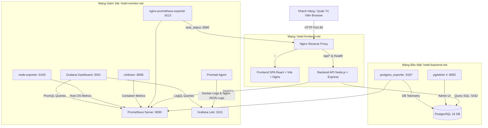

# 🏨 HỆ THỐNG ĐẶT PHÒNG KHÁCH SẠN 5 SAO - AURORA GRAND RESORT & SPA
## ĐỀ TÀI 6: TRIỂN KHAI VÀ QUẢN TRỊ HỆ THỐNG PHẦN MỀM BẰNG DOCKER COMPOSE

---

## 📌 GIỚI THIỆU DỰ ÁN

Dự án **Hệ Thống Đặt Phòng Khách Sạn (Aurora Grand Resort & Spa)** là một hệ sinh thái ứng dụng web hoàn chỉnh kết hợp hạ tầng container hóa hiện đại, đáp ứng các tiêu chuẩn khắt khe về **Triển khai**, **Quản trị hệ thống**, **Giám sát hiệu năng (Monitoring)**, **Thu thập log tập trung (Logging)** và **Bảo mật mạng (Security)**.

### 🌟 Tính năng nổi bật của Hệ thống:
1. **Giao diện tiếng Việt sang trọng chuẩn 5 sao:** Tông màu vàng kim (Gold) và xanh thẫm (Deep Slate/Navy), hiệu ứng kính mờ (Glassmorphism), hiển thị mượt mà trên cả máy tính và điện thoại.
2. **Trang chủ trực quan:** Giới thiệu resort, tiện ích 5 sao đặc quyền (Hồ bơi vô cực, Spa thảo mộc, Fine dining Michelin...), danh sách phòng nổi bật và thanh tìm kiếm nhanh.
3. **Trang danh sách phòng & Lọc đa tiêu chí:**
   - Lọc theo loại phòng (Deluxe Ocean, Premier Suite, Family Paradise, Presidential, Villa hồ bơi riêng).
   - Lọc theo khoảng giá (Dưới 2 triệu, 2 - 5 triệu, Trên 5 triệu).
   - Lọc theo sức chứa (1-2 người, 3-4 người, 5+ người).
   - Lọc theo ngày nhận/trả phòng (tự động loại trừ các phòng đã có người đặt trong khoảng ngày đã chọn).
   - Tìm kiếm theo từ khóa / số phòng.
   - Sắp xếp giá tăng dần / giảm dần.
4. **Trang chi tiết phòng:** Thư viện ảnh chất lượng cao, thông số diện tích, tầng, loại giường, tiện nghi đầy đủ, chính sách hủy phòng và nhận/trả phòng.
5. **Luồng Đặt phòng thông minh & An toàn:**
   - Nhập họ tên, email, số điện thoại, số CCCD/CMND, ghi chú đặc biệt.
   - Chọn ngày nhận và ngày trả phòng (kiểm tra `check_out > check_in` và không cho phép chọn ngày quá khứ).
   - **Tính tổng tiền hoàn toàn tại Backend:** Không tin tưởng giá tiền từ Frontend gửi lên; backend tự động tính `total_amount = total_nights * room_price` an toàn.
   - **Chống đặt trùng phòng (Double-Booking Prevention):** Sử dụng Transaction cơ sở dữ liệu kết hợp khóa dòng dữ liệu (`SELECT ... FOR UPDATE`), bảo đảm an toàn dữ liệu kể cả khi có 2 yêu cầu đặt cùng phòng gửi đến cùng một tích tắc.
   - Phân tách dữ liệu: Lưu thông tin khách hàng vào bảng `customers`, đơn đặt vào bảng `bookings` và lịch sử trạng thái vào bảng `booking_status_history`.
   - Sinh mã đặt phòng duy nhất dạng `BK-XXXXXX` và xuất biên lai xác nhận có thể in trực tiếp.
6. **Tra cứu & Hủy đặt phòng bảo mật:**
   - **Xác thực 2 yếu tố (Mã đặt phòng + Email):** Khách hàng bắt buộc phải nhập đúng cả Mã đặt phòng VÀ Email đã đăng ký để tra cứu, ngăn chặn hoàn toàn việc người lạ xem trộm thông tin đặt phòng của người khác.
   - Cho phép khách tự hủy đơn đặt phòng nếu phòng đang ở trạng thái `confirmed` và cách ngày nhận phòng ít nhất 24 giờ.
   - Ghi nhận đầy đủ lý do hủy và người thực hiện vào bảng `booking_status_history` (Soft cancel, không xóa dữ liệu tùy tiện).
7. **Bảng Điều Khiển Quản Trị (Admin Dashboard) có Phân Quyền (RBAC):**
   - **Đăng nhập quản trị bằng Bcrypt & JWT:** Mật khẩu được băm an toàn, cấp phát Bearer Token có thời hạn.
   - **Bảo vệ API quản trị:** Không cho người dùng thông thường truy cập hoặc gọi các API quản trị (`/api/admin/*`, CRUD phòng, duyệt đơn).
   - Xem và quản lý danh sách khách hàng (Họ tên, email, SĐT, số CCCD, tổng chi tiêu).
   - Quản lý danh sách phòng: Xem, Thêm phòng mới, Cập nhật trạng thái (`available`, `occupied`, `maintenance`), Xóa phòng.
   - Quản lý đơn đặt phòng: Cập nhật trạng thái (Xác nhận, Check-in, Check-out, Hủy), xem nhật ký lịch sử thay đổi trạng thái (Audit Trail).
   - **Tab Trạng thái & Sức khỏe hệ thống (Health Check LIVE):** Hiển thị độ trễ CSDL theo thời gian thực (ms), Uptime, RAM, Node version và liên kết một chạm đến Grafana, Prometheus, Loki, pgAdmin, cAdvisor, Node Exporter.
8. **An toàn thông tin trong Log:** Hệ thống tự động lọc và ẩn (sanitize/redact) mật khẩu, token và thông tin nhạy cảm khỏi log ghi nhận của Loki/Promtail.

---

## 🏗️ KIẾN TRÚC TỔNG THỂ HỆ THỐNG



---

## 🛠️ CƠ SỞ DỮ LIỆU POSTGRESQL CHUẨN QUAN HỆ

Lược đồ cơ sở dữ liệu (`database/init.sql`) tuân thủ nghiêm ngặt các quy tắc:

```
users (id, username, password_hash, full_name, email, role, created_at)
  │
customers (id, full_name, email, phone, id_card, address, created_at)
  │
  ├──< bookings (id, booking_code, customer_id, room_id, check_in_date, check_out_date,
  │              num_guests, total_nights, room_price, total_amount, special_requests,
  │              status, payment_status, created_at, updated_at)
  │       │
  │       ├──< booking_status_history (id, booking_id, old_status, new_status, changed_by, notes, created_at)
  │
room_types (id, code, name, description, base_price, max_guests, bed_type, room_size, image_url)
  │
  └──< rooms (id, room_number, room_type_id, title, floor, price_per_night, max_guests, status, description, image_url, images, amenities)
```

- **Ràng buộc:** `CHECK (check_out_date > check_in_date)`, `CHECK (price_per_night > 0)`, `CHECK (status IN ('available', 'occupied', 'maintenance'))`.
- **Chỉ mục:** `idx_bookings_room_dates`, `idx_bookings_code`, `idx_bookings_customer`, `idx_customers_email`, `idx_customers_phone`, `idx_rooms_status`.

---

## 🌐 DANH SÁCH CỔNG PUBLIC VÀ TÀI KHOẢN MẶC ĐỊNH

| Dịch Vụ | URL Truy Cập | Tài Khoản / Mật Khẩu Demo | Mô Tả |
| :--- | :--- | :--- | :--- |
| **Website Khách Sạn (Chính)** | [http://localhost:80](http://localhost:80) | Không yêu cầu | Đặt phòng, tìm kiếm, tra cứu an toàn |
| **Trang Quản Trị (Admin)** | [http://localhost:80](http://localhost:80) *(Tab Quản trị)* | `admin` / `admin123` *(vai trò Admin)*<br>`staff` / `staff123` *(vai trò Staff)* | Quản lý phòng, đơn đặt phòng, xem khách hàng |
| **Backend API Healthcheck** | [http://localhost:80/health](http://localhost:80/health) | Không yêu cầu | Kiểm tra kết nối DB, uptime, RAM, latency |
| **Backend Prometheus Metrics**| [http://localhost:80/metrics](http://localhost:80/metrics) | Không yêu cầu | Metrics chuẩn của thư viện prom-client |
| **Grafana Dashboards** | [http://localhost:3001](http://localhost:3001) | `admin` / `admin` | 4 Dashboards dựng sẵn hiển thị đầy đủ chỉ số |
| **Prometheus Server** | [http://localhost:9090](http://localhost:9090) | Không yêu cầu | Tra cứu PromQL, xem trạng thái 6 Scrape Targets |
| **pgAdmin 4** | [http://localhost:8082](http://localhost:8082) | `admin@hotel.com` / `AdminSecure2026!` | Quản trị CSDL PostgreSQL trực quan |
| **cAdvisor Containers** | [http://localhost:8085](http://localhost:8085) | Không yêu cầu | Xem tài nguyên trực tiếp của các container |
| **Node Exporter** | [http://localhost:9100/metrics](http://localhost:9100/metrics) | Không yêu cầu | Metrics phần cứng máy chủ |
| **Nginx Metrics Exporter** | [http://localhost:9113/metrics](http://localhost:9113/metrics) | Không yêu cầu | Metrics hiệu năng của Nginx |
| **PostgreSQL Exporter** | [http://localhost:9187/metrics](http://localhost:9187/metrics) | Không yêu cầu | Metrics hiệu năng của PostgreSQL |
| **Grafana Loki Ready** | [http://localhost:3101/ready](http://localhost:3101/ready) | Không yêu cầu | Trạng thái sẵn sàng của dịch vụ lưu log |
| **Nginx Stub Status** | [http://localhost:8089/stub_status](http://localhost:8089/stub_status) | Không yêu cầu | Endpoint nội bộ cho Nginx Exporter |
| **Cổng CSDL PostgreSQL** | `localhost:5433` | `hotel_admin` / `HotelSecurePassword2026!` | Dành cho DBeaver hoặc kết nối bên ngoài |

---

## 🚀 HƯỚNG DẪN KHỞI CHẠY VÀ VẬN HÀNH

### Bước 1: Khởi động toàn bộ cụm dịch vụ bằng Docker Compose
```bash
docker compose up -d
```

### Bước 2: Kiểm tra trạng thái các container
```bash
docker compose ps
```
Tất cả 13 dịch vụ sẽ hiển thị trạng thái `Up (healthy)` hoặc `Up`.

---

## 🧪 HƯỚNG DẪN KIỂM THỬ TỰ ĐỘNG (AUTOMATED TESTING)

Dự án cung cấp bộ kịch bản kiểm thử toàn diện từ kiểm tra mã HTTP, xác thực JWT, phân quyền, logic nghiệp vụ đặt phòng đến hệ thống giám sát.

### Chạy kiểm thử trên Windows (PowerShell):
```powershell
.\scripts\test-system.ps1
```

### Chạy kiểm thử trên Linux / macOS:
```bash
chmod +x ./scripts/*.sh
./scripts/test-system.sh
```

**Kịch bản kiểm thử tự động kiểm tra:**
1. Tính sẵn sàng của Nginx Reverse Proxy, Frontend SPA, Backend API (`/health` và `/metrics`).
2. **Xác thực và Phân quyền (Auth & RBAC):** Đăng nhập lấy JWT Token, kiểm tra chặn `401 Unauthorized` khi không có token, truy cập API quản trị khách hàng khi có token.
3. Lấy danh sách phòng và lọc danh mục.
4. Tạo đơn đặt phòng mới qua API (`POST /api/bookings`).
5. **Kiểm tra chống xung đột đặt trùng phòng (Double-Booking Prevention):** Thực hiện đặt trùng cùng phòng trong khoảng ngày đã có đơn -> Kỳ vọng nhận đúng mã lỗi `409 Conflict`.
6. **Kiểm tra tra cứu bảo mật:** Tra cứu đúng Mã VÀ đúng Email -> `200 OK`; Tra cứu đúng Mã nhưng sai Email -> `404 Not Found` (ngăn chặn xem trộm thông tin).
7. Kiểm tra trạng thái của Prometheus, Grafana, Loki, pgAdmin và 5 Exporters.

---

## 💾 SAO LƯU VÀ PHỤC HỒI CƠ SỞ DỮ LIỆU (DISASTER RECOVERY)

### 1. Sao lưu CSDL (Backup):
```powershell
# Trên PowerShell
.\scripts\backup-db.ps1

# Hoặc trên Linux Bash
./scripts/backup-db.sh
```

### 2. Phục hồi CSDL (Restore):
```powershell
# Trên PowerShell
.\scripts\restore-db.ps1

# Hoặc trên Linux Bash
./scripts/restore-db.sh
```

## 🔒 HƯỚNG DẪN KIỂM TRA NGINX & CHỨNG CHỈ HTTPS TỰ KÝ (COMMIT 1)

### 1. Kiểm tra Cú pháp Cấu hình Nginx
Để kiểm tra xem file cấu hình Nginx trong container có hợp lệ hay không:
```bash
docker exec hotel_nginx nginx -t
# Kết quả mong đợi:
# nginx: the configuration file /etc/nginx/nginx.conf syntax is ok
# nginx: configuration file /etc/nginx/nginx.conf test is successful
```

### 2. Cảnh báo Trình duyệt với Chứng chỉ Tự ký (Self-signed SSL)
Trong môi trường phát triển cục bộ và học tập, chứng chỉ SSL được sinh tự động bởi OpenSSL trong container [nginx/Dockerfile](file:///c:/Users/NAM/Documents/h%E1%BB%87%20th%E1%BB%91ng%20%C4%91%E1%BA%B7t%20ph%C3%B2ng%20kh%C3%A1ch%20s%E1%BA%A1n-kthp/nginx/Dockerfile). Do chứng chỉ này không được ký bởi một CA công cộng (Certificate Authority như DigiCert, Let's Encrypt), trình duyệt sẽ hiển thị cảnh báo bảo mật:
* **Thông báo cảnh báo:** *"Kết nối của bạn không phải là kết nối riêng tư"* hoặc `NET::ERR_CERT_AUTHORITY_INVALID`.
* **Cách vượt qua cảnh báo trên Chrome / Edge:** Nhấn nút **Nâng cao (Advanced)** $\rightarrow$ Chọn **Tiếp tục truy cập localhost (không an toàn)**. (Hoặc gõ chuỗi phím `thisisunsafe` khi đang ở màn hình cảnh báo).
* **Cách vượt qua cảnh báo trên Firefox:** Nhấn **Nâng cao** $\rightarrow$ Chọn **Chấp nhận rủi ro và tiếp tục**.

### 3. Kiểm tra HTTPS qua Command Line bằng `curl -k`
Vì chứng chỉ là tự ký, lệnh `curl` thông thường sẽ báo lỗi `SSL certificate problem: self-signed certificate`. Bạn cần thêm cờ `-k` (hoặc `--insecure`) để bỏ qua bước xác thực CA:
```bash
# Kiểm tra HTTPS cổng 443 và xem Security Headers
curl -k -I https://localhost/

# Kiểm tra phản hồi API qua HTTPS
curl -k https://localhost/health
```

### 4. Thu thập Access Log & Error Log cho Promtail
Nginx ghi nhận đồng thời 2 file log trong volume `nginx_logs` (`/var/log/nginx`):
* `access.log`: Ghi nhận theo định dạng JSON có cấu trúc (`json_analytics`), cung cấp thông tin IP, status code, latency, user-agent phục vụ Promtail phân tích trường tự động.
* `error.log`: Ghi nhận các cảnh báo (`warn`) và lỗi của Nginx.
Promtail tự động đọc 2 tệp này và đẩy về Grafana Loki theo chu kỳ.

---

## 📈 HƯỚNG DẪN KIỂM TRA PROMETHEUS TARGETS & GRAFANA (COMMIT 2)

### 1. Kiểm tra Trang Targets của Prometheus Server
Truy cập giao diện quản trị Prometheus tại: **[http://localhost:9090/targets](http://localhost:9090/targets)**

Tất cả **6 Scrape Jobs** phải ở trạng thái **`UP (1/1)`** màu xanh lá cây:
| Job Name | Endpoint Cào Dữ Liệu | Trạng Thái Mong Đợi | Mục Đích Thu Thập |
| :--- | :--- | :--- | :--- |
| `prometheus` | `localhost:9090/metrics` | `UP` | Tự giám sát tiến trình Prometheus |
| `hotel-backend` | `backend:5000/metrics` | `UP` | Lượt đặt, doanh thu, thời gian xử lý API Node.js |
| `postgres-exporter` | `postgres-exporter:9187/metrics` | `UP` | Số kết nối CSDL, Cache Hit, Commit/Rollback |
| `nginx-exporter` | `nginx-exporter:9113/metrics` | `UP` | Active connections, số lượng requests Nginx |
| `cadvisor` | `cadvisor:8080/metrics` | `UP` | Mức chiếm dụng CPU, RAM, Network I/O từng container |
| `node-exporter` | `node-exporter:9100/metrics` | `UP` | Tài nguyên CPU, RAM, Disk của hệ điều hành host |

> [!TIP]
> Nếu có bất kỳ target nào báo `DOWN`, kiểm tra ngay bằng lệnh `docker compose ps` để xác định container đó đã khởi động thành công và tham gia đúng mạng `hotel-monitor-net` hay chưa.

### 2. Kiểm tra Hệ thống Cảnh báo (Alert Rules)
Truy cập **[http://localhost:9090/alerts](http://localhost:9090/alerts)** để xem danh sách 5 quy tắc cảnh báo:
* `ServiceDown`: Kích hoạt khi có dịch vụ ngừng hoạt động quá 30 giây.
* `ApiHighLatency`: Kích hoạt khi độ trễ p95 vượt quá 1 giây trong 2 phút.
* `ApiHighErrorRate`: Kích hoạt khi tỷ lệ mã lỗi 5xx vượt 5%.
* `PostgresHighConnections`: Kích hoạt khi CSDL đạt trên 80% số kết nối cho phép.
* `NginxHighConnections`: Kích hoạt khi Nginx có trên 500 kết nối hoạt động.

### 3. Kiểm tra 4 Dashboards Tự Động Provision trong Grafana
Đăng nhập Grafana tại **[http://localhost:3001](http://localhost:3001)** (`admin` / `admin`):
1. **Hệ Thống Khách Sạn - Tổng Quan & Hiệu Năng Nghiệp Vụ (`hotel-overview-kthp`)**:
   - Hiển thị trực tiếp trạng thái `UP/DOWN` của cả 6 Scrape Targets.
   - Thống kê doanh thu tích lũy, phòng trống, lưu lượng request/s, p50/p95 latency.
   - Giám sát CPU/RAM của hệ điều hành Host và tiến trình Node.js.
2. **Hệ Thống Khách Sạn - Cơ Sở Dữ Liệu PostgreSQL (`postgres-metrics-kthp`)**:
   - Trạng thái `pg_up`, Active connections, Cache hit ratio (> 98%), Deadlocks.
3. **Hệ Thống Khách Sạn - Nginx Reverse Proxy (`nginx-metrics-kthp`)**:
   - Active, reading, writing, waiting connections, Throughput.
4. **Hệ Thống Khách Sạn - Giám Sát Docker Containers (`cadvisor-containers-kthp`)**:
   - Real-time CPU, RAM và Network I/O của từng container trong 13 dịch vụ.

---

## 📜 HƯỚNG DẪN TRUY VẤN LOG TẬP TRUNG BẰNG LOKI & LOGQL (COMMIT 3)

### 1. Hướng dẫn Tạo Traffic Thử Nghiệm Phát Sinh Log
Để Promtail thu thập log và đẩy về Loki, hãy tạo lưu lượng truy cập mẫu:
```bash
# Gửi request bình thường vào trang chủ và API (Status 200)
curl http://localhost/
curl http://localhost/api/rooms

# Gửi request vào đường dẫn không tồn tại để sinh log lỗi (Status 404)
curl http://localhost/api/duong-dan-khong-ton-tai

# Gửi phương thức trái phép để sinh log chặn bảo mật (Status 405)
curl -X POST http://localhost/

# Chạy toàn bộ 19 test case để sinh lưu lượng đầy đủ
.\scripts\test-system.ps1   # (hoặc ./scripts/test-system.sh trên Linux)
```

### 2. Các Bước Mở Grafana Explore & Chọn Data Source Loki
1. Đăng nhập Grafana tại [http://localhost:3001](http://localhost:3001) với tài khoản `admin` / `admin`.
2. Tại thanh điều hướng bên trái, nhấp vào biểu tượng la bàn **Explore** (hoặc truy cập trực tiếp [http://localhost:3001/explore](http://localhost:3001/explore)).
3. Tại dropdown chọn nguồn dữ liệu ở góc trên bên trái, chọn **Loki** (đã được provision tự động qua file cấu hình Git).

### 3. Bốn Truy Vấn LogQL Chuẩn Xác Theo Nhãn Thực Tế:

#### Truy vấn 1: Xem Access Log của Nginx Reverse Proxy
* **Mục đích:** Theo dõi toàn bộ lưu lượng web truy cập vào hệ thống theo thời gian thực.
* **Cú pháp LogQL:**
  ```logql
  {job="nginx"}
  ```
* **Giải thích:** Cấu hình Promtail sử dụng nhãn `job="nginx"` để đọc file `/var/log/nginx/access.log`. Do Nginx ghi log dạng JSON, toàn bộ các trường `client_ip`, `request_uri`, `request_method`, `status` được tự động bóc tách.

#### Truy vấn 2: Tìm các Request gặp Lỗi Server HTTP 5xx
* **Mục đích:** Phát hiện tức thì các sự cố ứng dụng backend bị lỗi hoặc quá tải (500 Internal Server Error, 502 Bad Gateway, 503 Service Unavailable).
* **Cú pháp LogQL (Lọc theo trường JSON):**
  ```logql
  {job="nginx"} | status >= 500
  ```
* **Cú pháp LogQL (Lọc theo biểu thức Regex):**
  ```logql
  {job="nginx"} |~ "\"status\":5[0-9][0-9]"
  ```
* **Giải thích:** Promtail đã parse trường `status` dạng số nguyên trong pipeline stage JSON, cho phép dùng toán tử so sánh `status >= 500` hoặc regex khớp với mã 5xx.

#### Truy vấn 3: Tìm Lỗi Trong Log Backend (Node.js Express)
* **Mục đích:** Truy vết các sự cố ngoại lệ (Exception), lỗi kết nối CSDL hoặc lỗi logic nghiệp vụ trong Backend.
* **Cú pháp LogQL:**
  ```logql
  {job="backend"} |= "error"
  ```
* **Giải thích:** Promtail thu thập log ứng dụng backend từ `/var/log/backend/*.log` với nhãn `job="backend"`. Bộ lọc `|= "error"` lọc ra các dòng log chứa chuỗi `"error"` hoặc có trường `"level":"error"`.

#### Truy vấn 4: Đếm Số Dòng Log Nginx Trong Khoảng Thời Gian 5 Phút
* **Mục đích:** Đo lường tổng lưu lượng truy cập và tần suất phát sinh request trong cửa sổ trượt 5 phút để phân tích tải.
* **Cú pháp LogQL:**
  ```logql
  sum(count_over_time({job="nginx"}[5m]))
  ```
* **Giải thích:** Hàm `count_over_time` đếm số lượng dòng log thuộc luồng `{job="nginx"}` trong 5 phút qua, hàm `sum()` tổng hợp toàn bộ kết quả thành một chỉ số duy nhất để vẽ biểu đồ hoặc hiển thị dạng Stat panel.

> [!NOTE]
> **Bảo vệ Bí Mật & Quyền Riêng Tư Trong Log (Sanitization):**
> * Middleware [backend/src/middleware/logger.js](file:///c:/Users/NAM/Documents/h%E1%BB%87%20th%E1%BB%91ng%20%C4%91%E1%BA%B7t%20ph%C3%B2ng%20kh%C3%A1ch%20s%E1%BA%A1n-kthp/backend/src/middleware/logger.js) tự động khử toàn bộ dữ liệu mật khẩu (`password`), token xác thực (`token`), secret thành `[REDACTED]`.
> * Nhãn Log chỉ bao gồm các nhãn có độ biến thiên thấp (`job`, `service`, `level`, `status`, `method`), tuyệt đối không dùng Email hay Request ID làm label để tránh làm quá tải bộ nhớ Loki (Anti High-Cardinality).

---

## 🛡️ SÁU BIỆN PHÁP BẢO MẬT HỆ THỐNG (SECURITY HARDENING)

Dự án áp dụng toàn diện 6 biện pháp bảo mật đa tầng từ cấp độ hệ điều hành, container, mạng đến cơ sở dữ liệu:

### 1. Phân Quyền Non-Root Cho Container (Principle of Least Privilege)
* **Backend API:** Dockerfile cấu hình chạy dưới tài khoản `USER node` (UID 1000). Tiến trình Node.js tuyệt đối không chạy bằng quyền `root`.
  * *Bằng chứng kiểm tra:* `docker exec hotel_backend whoami` $\rightarrow$ Kết quả: `node`.
* **Frontend Web & Nginx:** Nginx master process chạy với quyền tối thiểu để mở cổng, các worker processes phục vụ traffic chạy dưới quyền user `nginx`.
* **Đánh giá quyền Exporter / Logging:** Các dịch vụ `cadvisor` và `node-exporter` chỉ yêu cầu quyền đọc (`:ro`) các thư mục tài nguyên hệ thống, không cấp quyền can thiệp vào máy chủ.

### 2. Cô Lập Mạng Đa Vùng (Network Segmentation)
* Hệ thống phân tách thành **3 mạng Docker bridge độc lập**:
  1. `hotel-frontend-net`: Nginx Reverse Proxy, Frontend SPA và Backend API.
  2. `hotel-backend-net`: Mạng bảo mật nội bộ kết nối Backend API, PostgreSQL và pgAdmin. Frontend và Internet **không thể truy cập trực tiếp**.
  3. `hotel-monitor-net`: Mạng telemetry dành riêng cho Prometheus, Grafana, Loki và các Exporter.
* **Bảo vệ Cổng CSDL:** Cổng mặc định `5432` của PostgreSQL **không được công khai ra Internet**. Trong file cấu hình, cổng CSDL chỉ ánh xạ nội bộ, biến `POSTGRES_PORT=5433` chỉ dùng cho mục đích kiểm tra lab và có thể đóng hoàn toàn trong production.

### 3. Quản Lý Secret & Cấu Hình An Toàn
* **Loại trừ khỏi Git:** File chứa mật khẩu thực tế `.env` được khai báo trong [.gitignore](file:///c:/Users/NAM/Documents/h%E1%BB%87%20th%E1%BB%91ng%20%C4%91%E1%BA%B7t%20ph%C3%B2ng%20kh%C3%A1ch%20s%E1%BA%A1n-kthp/.gitignore), không bao giờ bị commit lên Git.
* **Mẫu an toàn [.env.example](file:///c:/Users/NAM/Documents/h%E1%BB%87%20th%E1%BB%91ng%20%C4%91%E1%BA%B7t%20ph%C3%B2ng%20kh%C3%A1ch%20s%E1%BA%A1n-kthp/.env.example):** Chỉ chứa các giá trị placeholder, hướng dẫn quản trị viên thay đổi mật khẩu mạnh (`HotelSecurePassword2026!`).
* **Đánh giá kiến trúc:** File `.env` là giải pháp phù hợp và thuận tiện cho môi trường học tập/thực hành Lab. Trong môi trường doanh nghiệp quy mô lớn, các giải pháp quản lý secret chuyên dụng (như HashiCorp Vault, AWS Secrets Manager, Docker Secrets) sẽ được áp dụng thay thế.

### 4. Phân Quyền Cơ Sở Dữ Liệu Tối Thiểu (Database Least Privilege)
* **Tách biệt vai trò Quản trị và Ứng dụng:**
  * Tài khoản `hotel_admin`: Dùng riêng cho việc tạo bảng, migration và khởi tạo cấu trúc CSDL ban đầu.
  * Tài khoản ứng dụng `hotel_app_user`: Được tạo tự động trong [database/init.sql](file:///c:/Users/NAM/Documents/h%E1%BB%87%20th%E1%BB%91ng%20%C4%91%E1%BA%B7t%20ph%C3%B2ng%20kh%C3%A1ch%20s%E1%BA%A1n-kthp/database/init.sql). Chỉ được cấp quyền `SELECT, INSERT, UPDATE` trên các bảng nghiệp vụ, **không có quyền `DROP TABLE`, `ALTER TABLE` hay quyền Superuser**.
* **Hạn chế truy cập pgAdmin:** pgAdmin được cấu hình yêu cầu đăng nhập bằng email/mật khẩu quản trị và nằm trong mạng bảo mật `hotel-backend-net`.

### 5. Gia Cố Bảo Mật Nginx Reverse Proxy
* **Security Headers đầy đủ:** `X-Content-Type-Options: nosniff`, `X-Frame-Options: SAMEORIGIN`, `Referrer-Policy: strict-origin-when-cross-origin`, `Content-Security-Policy` (bảo vệ tài nguyên, cho phép font Google và ảnh Unsplash), `Strict-Transport-Security` (HSTS trên HTTPS 443).
* **Ẩn phiên bản máy chủ:** `server_tokens off;` (Header chỉ trả về `Server: nginx`, không tiết lộ số hiệu phiên bản).
* **Hạn chế phương thức HTTP:** Áp dụng `limit_except` chặn các method lạ (VD: `POST /` bị chặn `405 Method Not Allowed`).
* **Giới hạn kích thước:** `client_max_body_size 10M;` và `client_body_buffer_size 128k;` chống tấn công DoS tràn bộ đệm.
* **HTTPS với chứng chỉ tự ký:** Cấu hình trên cổng 443 hỗ trợ HTTP/2, TLSv1.2, TLSv1.3.

### 6. Gia Cố Bảo Mật Docker Container
* **Ngăn chặn nâng quyền (No New Privileges):** Toàn bộ các dịch vụ trọng yếu (`backend`, `frontend`, `nginx`, `postgres`) đều được thiết lập `security_opt: [no-new-privileges:true]`, vô hiệu hóa khả năng chiếm quyền qua setuid binary.
* **Không mount Docker Socket bừa bãi:** Tuyệt đối không mount `/var/run/docker.sock` vào các container ứng dụng (Backend, Frontend, CSDL, Proxy). Socket chỉ được gắn quyền đọc cho `promtail` và `cadvisor` để thu thập số liệu.
* **Image Pinning:** Toàn bộ image đều sử dụng tag phiên bản cố định (`postgres:16-alpine`, `node:20-alpine`, `nginx:1.27-alpine`, `prometheus:v2.54.1`, `grafana:11.2.0`, `loki:3.1.1`), không sử dụng `:latest` thiếu kiểm soát.
* **Giới hạn tài nguyên & Cơ chế phục hồi:** Toàn bộ 13 service đều có cấu hình giới hạn CPU, RAM (`deploy.resources.limits`) và cơ chế `healthcheck` tự động khởi động lại khi gặp sự cố.

---

## 🛠️ CÁC LỖI THƯỜNG GẶP VÀ CÁCH KHẮC PHỤC (TROUBLESHOOTING)

| Hiện tượng lỗi | Nguyên nhân chính | Cách khắc phục triệt để |
| :--- | :--- | :--- |
| **`Bind for 0.0.0.0:80 failed: port is already allocated`** | Cổng 80 đang bị IIS, Apache, Skype hoặc container cũ chiếm dụng | Tắt dịch vụ chiếm cổng bằng `netstat -ano \| findstr :80` rồi `taskkill /F /PID <PID>` hoặc đổi cổng trong file `.env` (VD: `HTTP_PORT=8088`). |
| **`Connection refused` khi backend gọi PostgreSQL** | Container DB đang khởi động và thực thi `init.sql`, chưa sẵn sàng nhận kết nối | Cơ chế `depends_on: { condition: service_healthy }` trong docker-compose tự động xử lý. Nếu chạy lẻ, chờ 10s để DB hoàn tất khởi tạo. |
| **`405 Method Not Allowed` khi gửi request API** | Gọi sai phương thức HTTP (VD: gửi `PUT` hoặc `DELETE` vào route chỉ cho phép `POST`) | Kiểm tra lại phương thức trong tài liệu API ([POST /api/bookings] hoặc [PUT /api/admin/bookings/:id/status]). |
| **Lỗi CSP khi load font / ảnh** | Nội dung ngoài domain cho phép của Content-Security-Policy | Cấu hình CSP trong `nginx/nginx.conf` đã cho phép `fonts.googleapis.com`, `fonts.gstatic.com` và `images.unsplash.com`. |
| **Lỗi phân quyền `/var/run/docker.sock` trên Linux** | User hiện tại không thuộc nhóm `docker` | Chạy lệnh `sudo usermod -aG docker $USER` và đăng nhập lại hoặc cấp quyền `sudo chmod 666 /var/run/docker.sock`. |

---

## 📦 QUY TRÌNH ĐẨY MÃ NGUỒN LÊN GITHUB THEO MÃ SỐ SINH VIÊN (MSSV)

> [!IMPORTANT]
> **Quy định của Giảng viên:** Tài khoản GitHub và tên Repository bắt buộc phải đặt theo **Mã số sinh viên (MSSV)** của bạn (ví dụ: `21110001/kthp-de6-hotel-booking`). Không được tự ý bịa mã số sinh viên.

### Kế hoạch 3 Commit bắt buộc đã được tạo sẵn theo quy chuẩn:
1. **COMMIT 1:** `feat: deploy hotel booking with nginx reverse proxy` (Khởi tạo hệ thống nền tảng: Frontend React, Backend Node.js, PostgreSQL, pgAdmin, Nginx reverse proxy với HTTPS tự ký và Security Headers).
2. **COMMIT 2:** `feat: add prometheus grafana monitoring` (Tích hợp hệ thống giám sát: Prometheus, Grafana 4 dashboards, cAdvisor, Node Exporter, Nginx Exporter, Postgres Exporter).
3. **COMMIT 3:** `feat: add loki logging and security hardening` (Bổ sung thu thập log tập trung Loki + Promtail, Hardening bảo mật đa tầng, bộ kiểm thử tự động, README và báo cáo hoàn chỉnh).

### Các lệnh để đẩy lên Repository của bạn:
```bash
# 1. Kiểm tra trạng thái Git sạch và không có thông tin nhạy cảm
git status

# 2. Thêm Remote URL chứa Mã số sinh viên của bạn:
# (Thay thế <MA_SO_SINH_VIEN> và <TEN_REPO_THEO_MSSV> bằng thông tin thật của bạn)
git remote add origin https://github.com/<MA_SO_SINH_VIEN>/<TEN_REPO_THEO_MSSV>.git

# 3. Đổi tên nhánh chính thành main
git branch -M main

# 4. Đẩy mã nguồn và lịch sử 3 commit lên GitHub
git push -u origin main
```

---

## 👨‍💻 THÔNG TIN ĐỒ ÁN HỌC PHẦN
- **Môn học:** Triển khai và Quản trị Hệ thống Phần mềm
- **Đề tài:** ĐỀ 6 - HỆ THỐNG ĐẶT PHÒNG KHÁCH SẠN
- **Công nghệ chính:** Docker Compose, React + Vite, Node.js + Express, PostgreSQL 16, Nginx, Prometheus, Grafana, Loki, Promtail, cAdvisor, Node Exporter.
